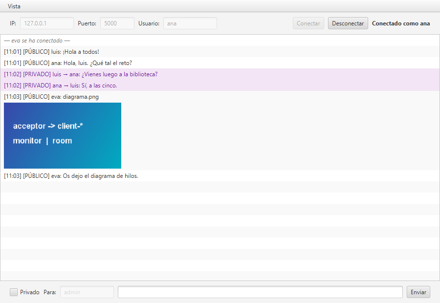
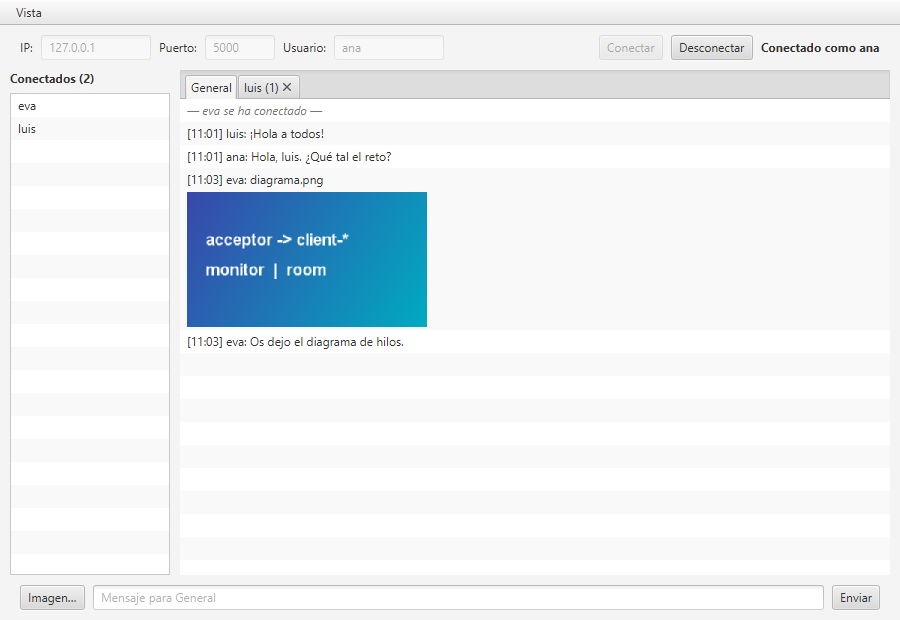

# Multiuser Chat

Multiuser chat built for the PSP course (2º DAM) challenge. It has two parts:

- a console **server** that serves each client on its own thread;
- a JavaFX **client** with two user interfaces.

Client and server talk over TCP sockets with `ObjectOutputStream` / `ObjectInputStream`. The client's interface is in Spanish, as in the course screenshot.

| Classic UI ("Clásica") | Advanced UI ("Avanzada") |
|---|---|
|  |  |

## Requirements

- JDK 21 or newer (tested on Windows 11 with Temurin JDK 25)
- Maven 3.9 or newer

## Project layout

| Module | Folder in the statement | Contents |
|---|---|---|
| `chat-core` | — | Protocol packets and rules, plus `ObjectChannel`. Server and client share this module. |
| `chat-server` | "Servidor" | Console server |
| `chat-client` | "Cliente" | JavaFX client with the classic and advanced views |

[docs/architecture.md](docs/architecture.md) explains the design and the alternatives we considered.

## Build and test

Run every command from the repository root.

```bash
mvn clean install     # compiles, runs tests and Checkstyle rules, installs the modules
mvn verify            # tests and Checkstyle only
mvn javadoc:javadoc   # API documentation; fails on any Javadoc warning
```

## Running the server

Run `mvn install` once first. Then start the server:

```bash
mvn -q -pl chat-server exec:java
```

Pass options through `exec.args`:

```bash
mvn -q -pl chat-server exec:java "-Dexec.args=--port=5000 --max-clients=3 --monitor-interval=5"
```

| Option | Default | Meaning |
|---|---|---|
| `--port` | `5000` | TCP port the server listens on |
| `--max-clients` | `10` | Maximum number of connected users. The server rejects extra connections with "server full". |
| `--monitor-interval` | `10` | Seconds between two `[MONITOR]` lines on the console |

Stop the server with **Ctrl+C**. Every connected client is told the server is closing.

The first time, Windows Firewall may ask whether Java can use the network. Allow it on private networks if you want to chat between computers.

## Running clients

Open one terminal per client and start the client in each:

```bash
mvn -q -pl chat-client javafx:run
```

## Choosing and switching the UI

When the client starts, it asks **"¿Qué interfaz quieres usar?"**:

- **Clásica (rúbrica)** is the window of the course screenshot.
- **Avanzada (usuarios y pestañas)** shows the connected users and one tab per conversation.

Both views run on the same session. To switch while connected, use the **Vista** menu (**Clásica** / **Avanzada**). Switching keeps the connection and the whole message history; the server does not even notice.

## Using the classic UI ("Clásica")

The classic view reproduces the window of the course screenshot. It has the connection bar at the top, every message in one list, and the private-message controls at the bottom.

1. **Connect.** Fill in **IP**, **Puerto** and **Usuario**, then press **Conectar**.
   - An empty IP means `127.0.0.1`; an empty port means `5000`.
   - The name needs 3 to 16 letters, digits or `_`.
   - While connected, the status label shows `Conectado como <name>` and the window title shows your name.
2. **Public message.** Type in the bottom field and press **Enviar** (or Enter). Everyone receives it:
   ```
   [12:01] [PÚBLICO] ana: hola
   ```
3. **Private message.** Tick **Privado**, write the recipient in **Para** and send. Only the recipient and you see it, highlighted in violet:
   ```
   [12:02] [PRIVADO] ana → luis: ¿vienes?
   ```
4. **Notices and errors.**
   - Gray lines report users joining and leaving, for example `— luis se ha conectado —`.
   - Errors appear in red in the list and in a dialog.
5. **Disconnect.** Press **Desconectar** or close the window. The other users see that you left.

## Using the advanced UI ("Avanzada")

The advanced view keeps the same connection bar. It replaces the «Privado» checkbox and the «Para» field with conversation tabs: **the selected tab decides who receives your message**.

- **Connected users.** The list on the left, titled **Conectados (n)**, shows everybody else who is online and updates live as people join and leave.
- **General tab.** Public chat; this tab cannot be closed. The message field shows `Mensaje para General`.
- **Private tabs.**
  - **Double-click** a user in the list to open (or jump to) a private tab with that user. The field then shows `Mensaje privado para <user>`.
  - When someone writes to you privately, a tab with their name opens **without stealing your focus**.
  - Close a private tab with its **×**. The conversation is kept, so reopening the tab shows the history again.
- **Unread counters.** A tab that is not selected shows how many new lines it has, for example `luis (2)` or `General (3)`. The counter resets when you open the tab.
- **Users who leave.** If the other user of a private tab disconnects:
  - the tab turns grey and italic;
  - sending is disabled while that tab is selected;
  - everything is re-enabled if the user comes back.

## Sharing images

**Sending (Avanzada only).** Press **Imagen…** next to the message field and choose a `png`, `jpg`, `jpeg` or `gif` file of at most **2 MB**. The image goes to the conversation of the selected tab: to everyone from **General**, or privately from a user's tab.

**Viewing (both views).** Images appear as a thumbnail under a header line, for example `[12:03] [PÚBLICO] luis: foto.png`.

- **Click a thumbnail** to open the image at full size in its own window.
- The classic view has no button to send images, but it shows every image it receives.

If a file is empty or larger than 2 MB, the client refuses it with `La imagen está vacía o supera el máximo de 2 MB.` The server checks the size too.

Messages you may see:

| Message | Meaning |
|---|---|
| `El servidor está lleno. Inténtalo más tarde.` | The server reached `--max-clients` |
| `El nombre «ana» ya está en uso.` | Another connected user has that name; case is ignored |
| `No se pudo conectar con 127.0.0.1:5000. ¿Está el servidor arrancado?` | Nothing is listening on that address |
| `El usuario luis no está conectado.` | The private recipient is not online |
| `El servidor se ha cerrado.` | The server was stopped |
| `Se ha perdido la conexión con el servidor.` | The connection broke unexpectedly |

## Monitor and logs

- Every `--monitor-interval` seconds, the server console shows a line like this:
  ```
  [MONITOR] Online users: 2/10 | Uptime: 00:05:10 | Last message: [12:01:22] ana -> all: hola
  ```
- `logs/server.log` is the server's global log. It records connections, rejections, disconnections and every public and private message, with the thread and the user. Older files roll over daily or at 5 MB.
- `chat-client/logs/client-<timestamp>.log` holds one file per client run. `javafx:run` starts the client from its module folder.

## Delivery

Build the zip from the release tag. It contains every tracked file of that version:

```bash
git archive --format=zip -o multiuser-chat.zip v1.2.1
```

| Folder in the zip | Folder asked by the statement |
|---|---|
| `chat-server/` | Servidor |
| `chat-client/` | Cliente |
| `chat-core/` | Shared by both: the protocol classes must be identical on both sides |

We follow Java and Maven naming conventions, so the folders are not named "Servidor" and "Cliente". The parent `pom.xml` builds the three modules together.

## Troubleshooting

- **Warnings about restricted methods or `sun.misc.Unsafe`** appear on JDK 24+. They come from JavaFX 21 and are harmless.
- **"Address already in use"** means port 5000 is taken. Start the server with `--port=<other>` and use that port in the clients.
